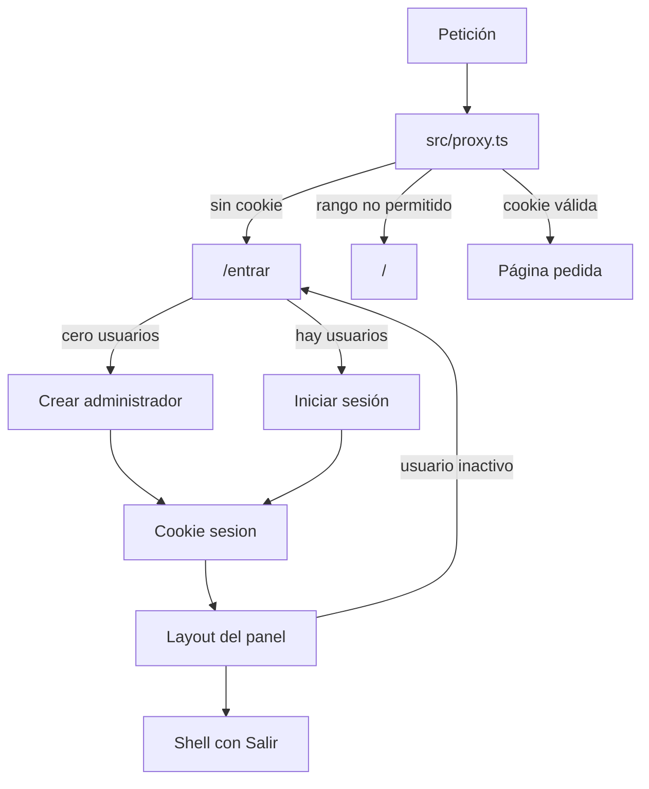

# Autenticación

## Propósito

Controla quién entra al panel de materia prima. Si la base no tiene usuarios, la misma pantalla crea el primer administrador. Después pide usuario y clave, firma una cookie de sesión y deja pasar solo a las rutas que corresponden al rango. El botón **Salir** del encabezado borra esa cookie.

## Quién lo usa

Cualquier persona que abre la aplicación. La primera vez, quien tenga la base vacía crea el administrador. A partir de ahí entran los rangos `administrador`, `recepcionista`, `pesador` y `consulta`. El alta de los demás usuarios está en [usuarios.md](usuarios.md).

`LOGIN_DESACTIVADO` en `src/lib/firma.ts` está en `false`. Si alguien lo pone en `true`, el proxy no pide sesión y todas las páginas actúan como el administrador de demostración.

## Pasos

1. Una visita a cualquier ruta distinta de `/entrar` y de `/api/impresion` pasa por `src/proxy.ts`.
2. Si no hay cookie `sesion` válida, el proxy redirige a `/entrar`. Cuando la ruta no es `/`, agrega `?siguiente=` con la ruta pedida.
3. `/entrar` lee la sesión. Si la cookie sigue vigente y el usuario está activo, redirige a `/`.
4. Si `usuarios` está vacía, el título es **Crear administrador**. El formulario pide nombre, usuario, clave y repetir clave, y llama a `crearPrimerAdministrador`. El rango queda fijo en `administrador`. Si las claves coinciden y la cuenta se crea, se abre la sesión y se va a `/`.
5. Si ya hay usuarios, el título es **Iniciar sesión**. `entrar` busca el usuario (sin distinguir mayúsculas), exige que esté activo y compara la clave con scrypt. Si falla, muestra «Usuario o clave incorrectos.»
6. Si entra, `guardarSesion` escribe la cookie `sesion` (httpOnly, `sameSite: lax`, ruta `/`, 12 horas) y redirige a `siguiente` solo si es una ruta interna que no es `/entrar`. Si no, va a `/`.
7. En cada página del panel, `src/app/(panel)/layout.tsx` vuelve a leer la cookie y comprueba en `usuarios` que el id siga activo. Si no, manda a `/entrar`.
8. El proxy también llama a `puedeEntrar`. Un rango que no puede ver esa ruta vuelve a `/`.
9. **Salir** ejecuta `cerrarSesion`, vacía la cookie y redirige a `/entrar`.

## Rutas y páginas

| Ruta | Qué hace |
| --- | --- |
| `/entrar` | Crear administrador o iniciar sesión |
| Cualquier otra ruta de la app, salvo estáticos y `/api/impresion` | Exige cookie y rango |
| Botón **Salir** del encabezado | Cierra la sesión |

El matcher del proxy deja fuera `_next/static`, `_next/image`, `favicon.ico` y `logo-purolomo.png`.

Rangos y rutas (`src/lib/acceso.ts`):

- `administrador`: todas las rutas.
- Cualquier rango con sesión: `/`, `/stock`, `/inventario`, `/nomenclatura`, `/logistica`, `/registro-entrada`, `/pesajes`, `/minilotes`, `/consulta-pesaje`, `/qr`, `/etiquetas`, `/historial` y `/lote`.
- `recepcionista`, además: `/entradas`.
- `pesador`, además: `/salidas`.
- `/usuarios`, `/receta` y `/eliminar` quedan solo para el administrador, porque no están en esas listas.

El menú lateral oculta ítems según el mismo criterio, pero el proxy es el que impide abrir la URL.

## Componentes

- `FormularioEntrada`: formulario de alta o de entrada.
- `LogoPurolomo`: logo de la pantalla de acceso y del menú.
- `Shell`: muestra el nombre, el rango y el botón **Salir**.

## Server actions

En `src/app/usuarios-acciones.ts`:

- `entrar`
- `crearPrimerAdministrador`
- `cerrarSesion`

No hay route handler de login. La firma y la lectura de la cookie viven en `src/lib/firma.ts` y `src/lib/usuarios.ts`.

## Tablas y consultas

La aplicación entra con la conexión directa de Postgres (`DATABASE_URL`). No usa la API de Supabase ni la clave anónima.

RLS está activado en `usuarios` y no hay políticas. Con RLS sin políticas, el rol `anon` de la API pública no lee ni escribe la tabla. La conexión directa de la aplicación no pasa por esas políticas.

Consultas de este flujo:

- `SELECT COUNT(*) AS n FROM usuarios` para saber si hay que crear el administrador.
- `SELECT * FROM usuarios WHERE lower(usuario) = lower(?)` al autenticar.
- `INSERT INTO usuarios (nombre, usuario, clave, rango) VALUES (?, ?, ?, ?)` al crear el primero. La clave se guarda como `scrypt$sal$hash`.
- `SELECT activo FROM usuarios WHERE id = ?` en cada página del panel, para rechazar una sesión de un usuario desactivado.

La cookie no guarda la clave. Guarda id, usuario, nombre, rango y expiración, firmados con HMAC SHA-256.

## Variables de entorno

- `SESION_SECRETO`: secreto con el que se firma la cookie. En producción tiene que estar definido. Si falta, el código usa un texto fijo; no hay que copiar ese texto a la documentación ni a los logs.
- `DATABASE_URL`: conexión Postgres. Si no está, se usa `POSTGRES_URL`.
- `DB_MAX_CONEXIONES`: tope de conexiones fuera de Vercel. En Vercel el código fuerza una conexión cuando existe la variable `VERCEL`.

## Archivos relacionados

- [src/app/entrar/page.tsx](../src/app/entrar/page.tsx)
- [src/components/formulario-entrada.tsx](../src/components/formulario-entrada.tsx)
- [src/components/logo.tsx](../src/components/logo.tsx)
- [src/components/ui/button.tsx](../src/components/ui/button.tsx)
- [src/components/shell.tsx](../src/components/shell.tsx)
- [src/app/(panel)/layout.tsx](<../src/app/(panel)/layout.tsx>)
- [src/app/usuarios-acciones.ts](../src/app/usuarios-acciones.ts)
- [src/lib/usuarios.ts](../src/lib/usuarios.ts)
- [src/lib/claves.ts](../src/lib/claves.ts)
- [src/lib/firma.ts](../src/lib/firma.ts)
- [src/lib/acceso.ts](../src/lib/acceso.ts)
- [src/lib/acceso.test.ts](../src/lib/acceso.test.ts)
- [src/proxy.ts](../src/proxy.ts)
- [src/lib/db.ts](../src/lib/db.ts)
- [src/app/layout.tsx](../src/app/layout.tsx)
- [public/logo-purolomo.png](../public/logo-purolomo.png)
- [supabase/esquema.sql](../supabase/esquema.sql)
