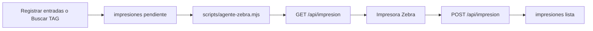

# Impresión Zebra

## Propósito

Encola etiquetas de cava y las manda a la impresora Zebra de la oficina. La aplicación guarda el trabajo en Postgres y genera ZPL. Un agente que corre junto a la impresora pide el siguiente trabajo, lo envía y confirma si salió.

Se dispara desde **Registrar entradas** (todo el proceso) y desde **Buscar TAG** o la ficha del TAG (un solo TAG, también para reimprimir).

## Quién lo usa

Encolar exige rango `administrador` o `recepcionista` (`exigirRango` en `imprimirEtiquetasPendientes` e `imprimirEtiquetaZebra`).

El agente de la impresora no inicia sesión. `src/proxy.ts` deja pasar `/api/impresion` sin cookie. La ruta exige la cabecera `x-impresion-clave`.

## Pasos

1. Al imprimir un proceso cerrado, `encolarEtiquetasDelProceso` toma los lotes de ese `proceso_id` con `impresa_en` vacío, crea una fila en `impresiones` con estado `pendiente` y una fila por TAG en `impresion_items`. Cada lote queda con `impresa_en = 'cola:<id>'`.
2. Al imprimir un TAG suelto, `encolarEtiquetaTag` hace lo mismo con un solo ítem. Si ese TAG ya está en una cola (`impresa_en` empieza por `cola:`), no lo encola de nuevo. Sí permite reimprimir un TAG que ya se imprimió o que se guardó sin imprimir.
3. `scripts/agente-zebra.mjs` hace `GET /api/impresion` con la cabecera `x-impresion-clave`.
4. `tomarImpresion` devuelve a `pendiente` los trabajos que llevan más de dos minutos en `imprimiendo`, toma el pendiente más antiguo, lo marca `imprimiendo` y responde `{ id, zpl }`. Si no hay trabajo, responde `{ id: null, zpl: "" }`.
5. El ZPL sale de `zplDeLotes`: una etiqueta por lote con el QR corto `PUROLOMO MPC` / `TAG:<tag>`.
6. El agente envía el ZPL por red al host y puerto de la Zebra, o a la impresora de Windows si no hay host.
7. Luego hace `POST /api/impresion` con `{ id, ok }`. Si `ok` es verdadero, el trabajo pasa a `lista` y `lotes.impresa_en` queda con la fecha ISO. Si no, el trabajo vuelve a `pendiente` para reintentarlo.



## Rutas y páginas

| Ruta | Qué hace |
| --- | --- |
| `/entradas` | Encola todas las etiquetas de un proceso cerrado |
| `/qr` y `/lote/[tag]` | Botón **Imprimir Zebra** de un TAG |
| `GET /api/impresion` | Entrega el siguiente ZPL |
| `POST /api/impresion` | Cierra o devuelve el trabajo |

El botón **Imprimir etiquetas** / **Imprimir QR** de `BotonImprimir` no usa esta cola: llama a `window.print()` del navegador.

## Componentes

- `ConfirmarAccion` en Registrar entradas, con la pregunta «¿Estás seguro de imprimir las etiquetas?».
- `BotonImprimirZebra` en la tarjeta QR. Pide confirmación en el navegador antes de enviar.

## Server actions y API routes

- `imprimirEtiquetasPendientes` y `imprimirEtiquetaZebra` en `src/app/actions.ts`.
- `GET` y `POST` en `src/app/api/impresion/route.ts`.

La comparación de la clave usa `timingSafeEqual`. Si `IMPRESION_CLAVE` no está definida, o no coincide en longitud y contenido con la cabecera, la ruta responde 401.

## Tablas y consultas

Tablas `impresiones`, `impresion_items` y `lotes`. RLS activado, sin políticas. La app y el agente (a través de la app) usan la conexión directa.

Encolar un proceso:

```sql
SELECT tag FROM lotes
WHERE proceso_id = ? AND impresa_en = ''
ORDER BY creado_en, tag
FOR UPDATE
```

```sql
INSERT INTO impresiones (estado) VALUES ('pendiente') RETURNING id
```

```sql
INSERT INTO impresion_items (impresion_id, tag, orden) VALUES (?, ?, ?)
```

```sql
UPDATE lotes SET impresa_en = ? WHERE tag = ?
```

Tomar un trabajo:

```sql
UPDATE impresiones
SET estado = 'pendiente', tomada_en = ''
WHERE estado = 'imprimiendo' AND tomada_en <> '' AND tomada_en < ?
```

```sql
SELECT id FROM impresiones WHERE estado = 'pendiente' ORDER BY id LIMIT 1 FOR UPDATE
```

```sql
UPDATE impresiones SET estado = 'imprimiendo', tomada_en = ? WHERE id = ?
```

```sql
SELECT tag FROM impresion_items WHERE impresion_id = ? ORDER BY orden
```

Cerrar:

```sql
UPDATE impresiones SET estado = 'lista', lista_en = ? WHERE id = ?
```

```sql
UPDATE lotes SET impresa_en = ?
WHERE tag IN (SELECT tag FROM impresion_items WHERE impresion_id = ?)
```

Si la impresión falla, el trabajo vuelve a `pendiente` y `tomada_en` queda vacío. `impresa_en` del lote sigue en `cola:<id>` hasta que un intento posterior lo marque con la fecha.

## Variables de entorno

De la aplicación, en Vercel y en local:

- `DATABASE_URL` o `POSTGRES_URL`.
- `IMPRESION_CLAVE`: secreto compartido con el agente. No va en el navegador.
- `SESION_SECRETO`: solo para quien encola desde el panel.

Del agente (`scripts/agente-zebra.mjs`), en la máquina de la impresora, no en el despliegue de Vercel:

- `PUROLOMO_URL`: origen de la app, sin barra final.
- `IMPRESION_CLAVE`: la misma clave.
- `ZEBRA_HOST` y `ZEBRA_PUERTO` (si no se define el puerto, el script usa 9100) para enviar por red.
- `ZEBRA_IMPRESORA`: nombre de la impresora de Windows, alternativa a `ZEBRA_HOST`.

Hace falta `ZEBRA_HOST` o `ZEBRA_IMPRESORA`.

## Archivos relacionados

- [src/app/api/impresion/route.ts](../src/app/api/impresion/route.ts)
- [src/lib/impresion.ts](../src/lib/impresion.ts)
- [src/lib/zpl-etiqueta.ts](../src/lib/zpl-etiqueta.ts)
- [src/lib/zpl-etiqueta.test.ts](../src/lib/zpl-etiqueta.test.ts)
- [src/lib/qr.ts](../src/lib/qr.ts)
- [src/lib/etiqueta-cava.ts](../src/lib/etiqueta-cava.ts)
- [src/lib/mpc.ts](../src/lib/mpc.ts)
- [src/lib/lotes.ts](../src/lib/lotes.ts)
- [src/app/actions.ts](../src/app/actions.ts)
- [src/components/boton-imprimir-zebra.tsx](../src/components/boton-imprimir-zebra.tsx)
- [src/components/boton-imprimir.tsx](../src/components/boton-imprimir.tsx)
- [src/components/confirmar-accion.tsx](../src/components/confirmar-accion.tsx)
- [src/components/qr-etiqueta.tsx](../src/components/qr-etiqueta.tsx)
- [src/proxy.ts](../src/proxy.ts)
- [src/lib/db.ts](../src/lib/db.ts)
- [scripts/agente-zebra.mjs](../scripts/agente-zebra.mjs)
- [supabase/esquema.sql](../supabase/esquema.sql)
