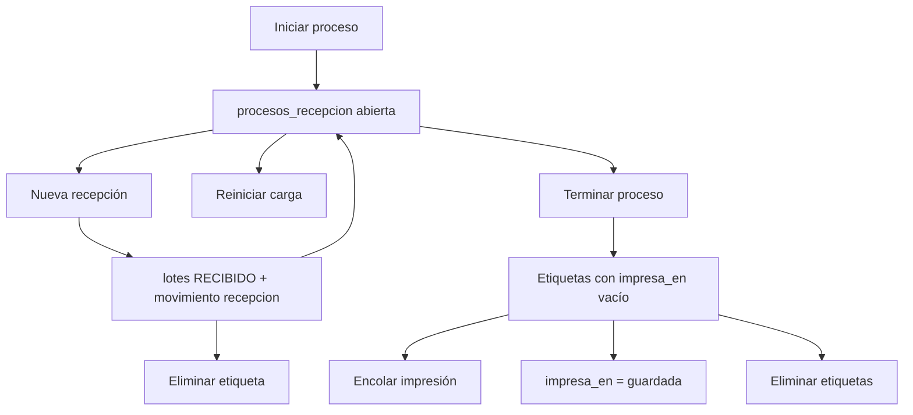

# Registrar entradas

## Propósito

Registra cada paleta de materia prima cárnica dentro de un proceso de recepción. El TAG es un número de 6 dígitos que no se puede repetir. Al cerrar el proceso, las etiquetas de esa carga quedan juntas para imprimirlas en la Zebra o guardarlas sin imprimir.

El menú lo llama **Registrar entradas**. No es la consulta histórica: esa es [registro-de-entrada.md](registro-de-entrada.md).

## Quién lo usa

`administrador` y `recepcionista`. El menú solo les muestra el ítem y el proxy solo les deja `/entradas`. Las acciones llaman a `exigirRango(["administrador", "recepcionista"])`.

## Pasos

1. Si no hay un proceso abierto ni etiquetas pendientes de imprimir, la página muestra **Iniciar proceso de recepción**.
2. `iniciarProcesoRecepcion` inserta una fila en `procesos_recepcion` con estado `abierta`. No deja abrir otro mientras ese siga abierto.
3. Con el proceso abierto aparece **Nueva recepción**. El formulario pide fecha, semana (1 a 53; si se deja vacía se calcula), TAG de 6 dígitos, producto del catálogo CDM, kilos y una observación de hasta 500 caracteres.
4. Mientras se escribe el TAG, `revisarTagEntrada` avisa si ya existe.
5. `crearRecepcion` valida, inserta el lote en estado `RECIBIDO` con kilos despachados y consumidos en 0, inserta un movimiento `recepcion` y asigna `lotes.proceso_id` al proceso abierto.
6. **Etiquetas de este proceso** muestra cada paleta. **Eliminar etiqueta** borra ese lote y su movimiento si sigue en recepción, sin kilos usados y sin mini lotes.
7. **Reiniciar carga** pide confirmación y borra todas las entradas del proceso abierto, con las mismas condiciones. Si alguna ya se usó, no reinicia.
8. **Terminar proceso** pasa el proceso a `cerrada` y anota `cerrada_en`. No imprime todavía.
9. **Etiquetas registradas** lista los procesos cerrados que aún tienen lotes con `impresa_en` vacío. Desde ahí se puede:
   - eliminar las seleccionadas o todas;
   - **Imprimir**, que encola el proceso en la Zebra (ver [impresion-zebra.md](impresion-zebra.md));
   - **Guardar SIN IMPRIMIR**, que marca `impresa_en = 'guardada'` y no crea un trabajo de impresión.
10. **Últimas paletas** muestra las 12 recepciones más recientes y enlaza cada TAG a su ficha.

## Rutas y páginas

| Ruta | Qué hace |
| --- | --- |
| `/entradas` | Proceso, formulario y últimas paletas |
| `/entradas?aviso=&tono=` | Aviso del último paso. `tono=ok` lo pinta en verde |

## Componentes

- `EntradaForm`: formulario de recepción y aviso de TAG ocupado.
- `EtiquetaCava`: vista previa de 5,7 cm × 3,2 cm.
- `ConfirmarAccion`: confirmación de imprimir o guardar sin imprimir.
- `TablaLotes`: últimas paletas.
- `PageFrame` y `Card`.

## Server actions

Todas en `src/app/actions.ts`:

- `revisarTagEntrada`
- `crearRecepcion`
- `iniciarProcesoRecepcion`
- `reiniciarProcesoRecepcion`
- `terminarProcesoRecepcion`
- `eliminarEtiquetaEnCurso`
- `eliminarEtiquetasPorImprimir`
- `guardarEtiquetasPendientes`
- `imprimirEtiquetasPendientes`

No hay route handler en `/entradas`. La impresión física la hace la cola descrita en [impresion-zebra.md](impresion-zebra.md).

## Tablas y consultas

Tablas `procesos_recepcion`, `lotes`, `movimientos` y, al comprobar si se puede borrar, `minilotes`. RLS activado en las cuatro, sin políticas. La app usa la conexión directa.

Proceso:

- `SELECT id FROM procesos_recepcion WHERE estado = 'abierta' ORDER BY id DESC LIMIT 1`
- `SELECT COUNT(*)::int AS n FROM lotes WHERE proceso_id = ?`
- `INSERT INTO procesos_recepcion (estado) VALUES ('abierta') RETURNING id`
- `UPDATE procesos_recepcion SET estado = 'cerrada', cerrada_en = ? WHERE id = ?`
- Procesos listos para imprimir: `procesos_recepcion` cerrados unidos a `lotes` con `impresa_en = ''`.

Recepción:

- `SELECT tag FROM lotes WHERE tag = ?`
- `INSERT INTO lotes (tag, fecha, semana, codigo, producto, kg_recibidos, kg_despachados, kg_consumidos, estado, observaciones, destino) VALUES (?, ?, ?, ?, ?, ?, 0, 0, ?, ?, ?) ON CONFLICT (tag) DO NOTHING`
- `INSERT INTO movimientos (tag, tipo, fecha, semana, kg, estado) VALUES (?, 'recepcion', ?, ?, ?, ?)`
- `UPDATE lotes SET proceso_id = ? WHERE tag = ?`
- `SELECT * FROM lotes WHERE proceso_id = ? ORDER BY creado_en, tag`

Borrar una entrada del proceso (en curso o pendiente de imprimir) exige estado `RECIBIDO`, kilos despachados y consumidos en 0, `impresa_en` vacío y cero filas en `minilotes`. Luego:

- `DELETE FROM movimientos WHERE tag = ?`
- `DELETE FROM lotes WHERE tag = ?`

Guardar sin imprimir: `UPDATE lotes SET impresa_en = 'guardada' WHERE tag = ?`.

El producto no sale de la tabla `productos`. `validarRecepcion` lo busca en `PRODUCTOS_MPC`.

## Variables de entorno

- `DATABASE_URL` o `POSTGRES_URL`.
- `SESION_SECRETO` para la sesión. Ver [autenticacion.md](autenticacion.md).

Encolar la impresión no usa otra variable en esta pantalla. La clave de la impresora está en [impresion-zebra.md](impresion-zebra.md).

## Archivos relacionados

- [src/app/(panel)/entradas/page.tsx](<../src/app/(panel)/entradas/page.tsx>)
- [src/components/entrada-form.tsx](../src/components/entrada-form.tsx)
- [src/components/etiqueta-cava.tsx](../src/components/etiqueta-cava.tsx)
- [src/components/confirmar-accion.tsx](../src/components/confirmar-accion.tsx)
- [src/components/tabla-lotes.tsx](../src/components/tabla-lotes.tsx)
- [src/components/page-frame.tsx](../src/components/page-frame.tsx)
- [src/components/ui/card.tsx](../src/components/ui/card.tsx)
- [src/components/ui/button.tsx](../src/components/ui/button.tsx)
- [src/components/ui/input.tsx](../src/components/ui/input.tsx)
- [src/components/ui/label.tsx](../src/components/ui/label.tsx)
- [src/components/ui/textarea.tsx](../src/components/ui/textarea.tsx)
- [src/app/actions.ts](../src/app/actions.ts)
- [src/lib/proceso-recepcion.ts](../src/lib/proceso-recepcion.ts)
- [src/lib/proceso-recepcion.test.ts](../src/lib/proceso-recepcion.test.ts)
- [src/lib/lotes.ts](../src/lib/lotes.ts)
- [src/lib/lotes.test.ts](../src/lib/lotes.test.ts)
- [src/lib/etiqueta-cava.ts](../src/lib/etiqueta-cava.ts)
- [src/lib/mpc.ts](../src/lib/mpc.ts)
- [src/lib/formato.ts](../src/lib/formato.ts)
- [src/lib/impresion.ts](../src/lib/impresion.ts)
- [src/lib/qr.ts](../src/lib/qr.ts)
- [src/lib/usuarios.ts](../src/lib/usuarios.ts)
- [src/lib/acceso.ts](../src/lib/acceso.ts)
- [src/proxy.ts](../src/proxy.ts)
- [src/lib/db.ts](../src/lib/db.ts)
- [src/app/(panel)/layout.tsx](<../src/app/(panel)/layout.tsx>)
- [src/components/shell.tsx](../src/components/shell.tsx)
- [supabase/esquema.sql](../supabase/esquema.sql)
