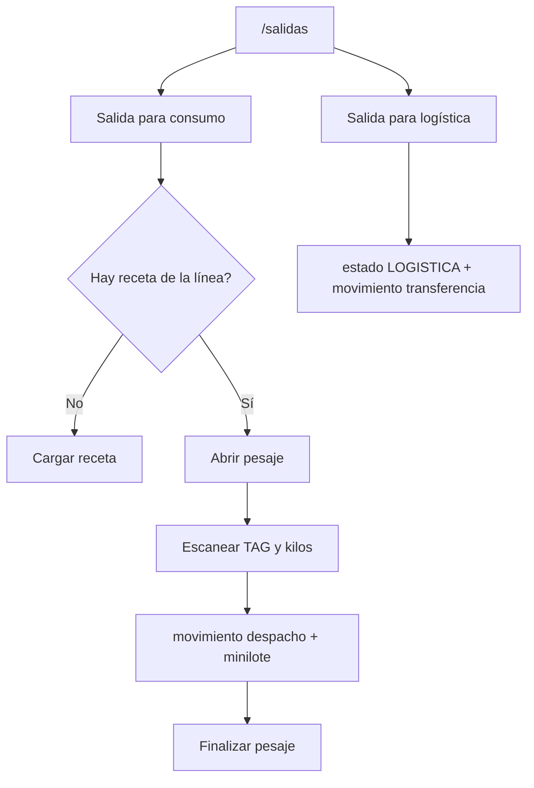

# Registrar salidas

## Propósito

Registra la salida de materia prima que está en cava. Hay dos modos:

- **Salida para consumo**: abre un pesaje de ALIBAL 1 K, escanea cada TAG y descuenta kilos según la receta de la línea.
- **Salida para logística**: saca el TAG de la cava. Queda en estado `LOGISTICA` y ya no se puede consumir.

El menú lo llama **Registrar salidas**. La planilla de lo ya pesado es [registro-de-pesajes.md](registro-de-pesajes.md). La receta que limita el consumo se carga en [cargar-receta.md](cargar-receta.md).

## Quién lo usa

`administrador` y `pesador` pueden abrir `/salidas`. El proxy no deja entrar a consulta ni a recepcionista.

Dentro de la página, **Salida para logística** solo se muestra si el rango es `administrador`, y `trasladarLogisticaFormulario` llama a `exigirAdmin`. El pesador solo ve el consumo.

Abrir, consumir, quitar kilos, finalizar y borrar un pesaje en curso exigen `administrador` o `pesador`.

## Pasos

### Elegir el modo

1. `/salidas` muestra **Salida para consumo**. El administrador también ve **Salida para logística**.
2. Consumo sigue en `/salidas?modo=consumo`. Logística, en `/salidas?modo=logistica`.
3. Si la URL trae `pesaje` o `token`, la página trata el modo como consumo aunque no venga `modo`.

### Salida para consumo

1. Hay que elegir el producto. El único destino de este modo es `ALIBAL 1 K` (`/salidas?modo=consumo&producto=ALIBAL%201%20K`).
2. Si esa línea no tiene receta vigente, la pantalla manda a **Cargar receta** y no deja abrir el pesaje.
3. **Abrir pesaje** pide fecha y línea (solo las líneas con receta). El número lo calcula `siguienteNumero` para ese destino. No se abre otro pesaje del mismo destino mientras haya uno con `finalizado = 0`.
4. `abrirPesaje` inserta en `pesajes` el número, la fecha, el destino, la línea y el `receta_id` vigente.
5. **Registrar consumo** pide el TAG (escrito o leído del QR) y los kilos. `loteActualDesdeTag` muestra el lote antes de guardar.
6. `consumirPesajeFormulario` comprueba que el tipo MPC del TAG esté en la receta, que los kilos quepan en el rango del tipo y en el máximo del pesaje, y que el TAG tenga kilos disponibles y no esté en logística.
7. `registrarDespacho` bloquea la fila del lote (`FOR UPDATE`), suma `kg_despachados`, agrega el destino a `lotes.destino`, inserta un movimiento `despacho` y crea el mini lote (`ML` más cuatro caracteres en base 36).
8. La página vuelve con `token=` para mostrar el mini lote recién creado. Se puede quitar ese retiro mientras el pesaje no esté finalizado: devuelve los kilos al lote y borra el mini lote y su movimiento.
9. Se puede anotar una observación del pesaje y finalizarlo. Al finalizar, `finalizado` pasa a 1 y `registrado_en` guarda la hora. El código del pesaje (número, línea y sufijo de cada mini lote) se arma al consultar; no es una columna.
10. **Eliminar el pesaje en proceso** pide la casilla de confirmación, devuelve todos los kilos y borra mini lotes, movimientos de esos retiros y el pesaje.

### Salida para logística

1. Se escribe el TAG o se escanea el QR. `loteActualDesdeTag` trae la ficha.
2. La observación es obligatoria, de hasta 500 caracteres.
3. `trasladarALogistica` bloquea el lote, exige que le queden kilos y que no esté ya en `LOGISTICA`.
4. Pone `estado = 'LOGISTICA'`, concatena la observación y agrega `LOGISTICA` al destino.
5. Inserta un movimiento `transferencia` con los kilos que quedaban.
6. Redirige a `/salidas?modo=logistica&trasladado=<tag>`, con enlace para descargar el QR actualizado.

## Rutas y páginas

| Ruta | Qué hace |
| --- | --- |
| `/salidas` | Elección de modo |
| `/salidas?modo=consumo` | Elección de producto y pesaje |
| `/salidas?modo=consumo&producto=ALIBAL%201%20K&pesaje=` | Pesaje en curso o consultado |
| `/salidas?modo=logistica` | Traslado a logística |
| `/salidas?modo=logistica&trasladado=` | Confirmación del traslado |

La ficha de un TAG enlaza a `/salidas?tag=`, pero la página no lee el parámetro `tag` para rellenar el formulario. El consumo y la logística piden el TAG otra vez.

## Componentes

- `SalidaAlibal`: abrir pesaje, consumir, quitar kilos, observar, finalizar y eliminar el pesaje en curso.
- `SalidaLogistica`: traslado.
- `EscanerSalida`: lectura del QR para ambos modos.
- `FormObservacion`: observación del pesaje.
- `PageFrame`, `Card`, `Button`, `Input`, `Label`.

`MovimientoForm` llama a `crearDespacho` y `crearConsumo`, pero ninguna página lo monta. `validarTransferencia` (estado `TRANSFIRIO`) tampoco tiene pantalla. El consumo real pasa por `consumirEnPesaje` → `registrarDespacho`, no por el formulario suelto.

## Server actions

En `src/app/actions.ts`:

- `numeroSiguientePesaje`
- `abrirPesajeFormulario`
- `loteActualDesdeTag` y `loteActualDesdeQr`
- `consumirPesajeFormulario`
- `quitarKgPesajeFormulario`
- `finalizarPesajeFormulario`
- `guardarObservacionPesajeFormulario`
- `eliminarPesajeEnCursoFormulario`
- `trasladarLogisticaFormulario`

`crearDespacho`, `crearConsumo` y `validarTransferencia` siguen exportadas para el formulario que no está montado.

## Tablas y consultas

Tablas `pesajes`, `recetas`, `receta_items`, `lotes`, `movimientos`, `minilotes` y `app_meta` (secuencia del mini lote). RLS activado, sin políticas. La app usa la conexión directa.

Pesaje:

- `SELECT * FROM pesajes WHERE destino = ? AND finalizado = 0 ORDER BY fecha DESC, numero DESC LIMIT 1`
- `SELECT COALESCE(MAX(numero), 0) AS numero FROM pesajes WHERE destino = ?`
- `INSERT INTO pesajes (numero, fecha, destino, linea, receta_id) VALUES (?, ?, ?, ?, ?) ON CONFLICT (fecha, destino, linea, numero) DO NOTHING RETURNING *`. Si el conflicto no devuelve fila, se lee con `SELECT * FROM pesajes WHERE fecha = ? AND destino = ? AND linea = ? AND numero = ?`
- `UPDATE pesajes SET finalizado = 1, registrado_en = ? WHERE id = ? AND finalizado = 0`
- `UPDATE pesajes SET observaciones = ? WHERE id = ?`
- `DELETE FROM pesajes WHERE id = ? AND finalizado = 0` al borrar el pesaje en curso

Consumo, dentro de una transacción que bloquea el lote:

- `SELECT * FROM lotes WHERE tag = ? FOR UPDATE`
- `UPDATE lotes SET kg_despachados = ?, estado = ?, destino = ? WHERE tag = ?`
- `INSERT INTO movimientos (tag, tipo, fecha, semana, kg, estado, nota, destino, linea) VALUES (?, 'despacho', ...)`
- `INSERT INTO minilotes (token, tag, pesaje_id, tipo, kg, destino, linea) VALUES (...)`
- La secuencia del token: `INSERT INTO app_meta (clave, valor) VALUES ('minilote_seq', '1') ON CONFLICT (clave) DO UPDATE SET valor = (app_meta.valor::integer + 1)::text`

Quitar un retiro borra el mini lote, revierte `kg_despachados` y borra el movimiento de ese despacho.

Logística:

- `UPDATE lotes SET estado = 'LOGISTICA', observaciones = ?, destino = ? WHERE tag = ?`
- `INSERT INTO movimientos (..., tipo 'transferencia', estado 'LOGISTICA', destino 'LOGISTICA')`

La receta vigente se lee de `recetas` (`vigente = 1`) y `receta_items`. Las existencias por tipo salen de `lotes` con `estado <> 'LOGISTICA'` y kilos restantes, cruzadas con el catálogo en memoria.

## Variables de entorno

- `DATABASE_URL` o `POSTGRES_URL`.
- `SESION_SECRETO`. Ver [autenticacion.md](autenticacion.md).

## Archivos relacionados

- [src/app/(panel)/salidas/page.tsx](<../src/app/(panel)/salidas/page.tsx>)
- [src/components/salida-alibal.tsx](../src/components/salida-alibal.tsx)
- [src/components/salida-logistica.tsx](../src/components/salida-logistica.tsx)
- [src/components/escaner-salida.tsx](../src/components/escaner-salida.tsx)
- [src/components/form-observacion.tsx](../src/components/form-observacion.tsx)
- [src/components/decodificar-imagen-qr.ts](../src/components/decodificar-imagen-qr.ts)
- [src/components/movimiento-form.tsx](../src/components/movimiento-form.tsx)
- [src/components/page-frame.tsx](../src/components/page-frame.tsx)
- [src/components/ui/card.tsx](../src/components/ui/card.tsx)
- [src/components/ui/button.tsx](../src/components/ui/button.tsx)
- [src/components/ui/input.tsx](../src/components/ui/input.tsx)
- [src/components/ui/label.tsx](../src/components/ui/label.tsx)
- [src/components/ui/textarea.tsx](../src/components/ui/textarea.tsx)
- [src/app/actions.ts](../src/app/actions.ts)
- [src/lib/pesajes.ts](../src/lib/pesajes.ts)
- [src/lib/pesajes.test.ts](../src/lib/pesajes.test.ts)
- [src/lib/lotes.ts](../src/lib/lotes.ts)
- [src/lib/lotes.test.ts](../src/lib/lotes.test.ts)
- [src/lib/recetas.ts](../src/lib/recetas.ts)
- [src/lib/minilote.ts](../src/lib/minilote.ts)
- [src/lib/destinos.ts](../src/lib/destinos.ts)
- [src/lib/lineas.ts](../src/lib/lineas.ts)
- [src/lib/mpc.ts](../src/lib/mpc.ts)
- [src/lib/qr.ts](../src/lib/qr.ts)
- [src/lib/formato.ts](../src/lib/formato.ts)
- [src/lib/usuarios.ts](../src/lib/usuarios.ts)
- [src/lib/acceso.ts](../src/lib/acceso.ts)
- [src/proxy.ts](../src/proxy.ts)
- [src/lib/db.ts](../src/lib/db.ts)
- [src/app/(panel)/layout.tsx](<../src/app/(panel)/layout.tsx>)
- [src/components/shell.tsx](../src/components/shell.tsx)
- [supabase/esquema.sql](../supabase/esquema.sql)
